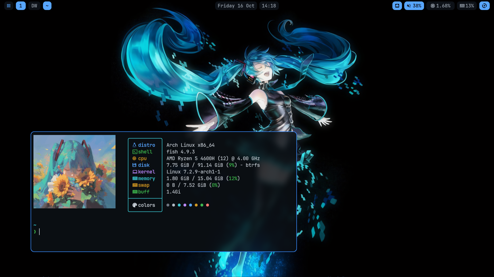

# dotfiles

Managed with chezmoi source naming.

- `dot_config/` — maps to `~/.config/` (`dot_` = leading dot). `private_` = private file mode, `executable_` = executable bit.
- `etc/`, `usr/` — system files that live outside `$HOME`; copy them with `sudo`, e.g.
  `sudo cp etc/sddm.conf.d/*.conf /etc/sddm.conf.d/` and
  `sudo cp -r usr/share/sddm/themes/orbital/* /usr/share/sddm/themes/orbital/`.
  Recorded here for reference/restore, not applied by chezmoi (see `.chezmoiignore`).

## Preview

## Contents

| Path | What |
| --- | --- |
| `dot_config/kitty/` | kitty terminal (JetBrainsMono Nerd Font, GitHub Dark colors) |
| `dot_config/mango/` | mangowm (dwindle, Super-based binds, blur, borders); `keybinds.sh` (Super+/ cheatsheet); `mangobar-preview.sh`; `wlogout/` power menu |
| `dot_config/mango/wallpaper/` | wallpapers (`miku-dark.png`, `miku.jpg`) |
| `dot_config/mangobar/` | status bar — athos-gruv layout, GitHub Dark, rounder/spaced, fuzzel app-list, wlogout power menu |
| `dot_config/fuzzel/` | launcher (GitHub Dark) |
| `dot_config/fontconfig/` | monospace → JetBrainsMono Nerd Font |
| `dot_config/fastfetch/` | fastfetch config + logo image (`miku.png`) |
| `dot_config/private_fish/` | fish shell (ctrl-arrow / ctrl-backspace word binds) |
| `dot_config/opencode/` | OpenCode CLI: github-transparent theme, openrouter-credit plugin |
| `etc/sddm.conf.d/` | SDDM: orbital theme, X11 greeter, cursor theme |
| `etc/fstab` | btrfs subvols (`@`,`@home`,`@var`), ext4 `/boot`, vfat ESP |
| `etc/default/grub` | GRUB_TIMEOUT=1 |
| `etc/mkinitcpio.conf` | no `kms` hook — NVIDIA kept out of the initramfs |
| `etc/systemd/zram-generator.conf.d/` | zram0 (zstd, 50% RAM) |
| `etc/xdg/reflector/` | reflector mirrorlist config (freedif excluded) |
| `etc/pacman.conf` | repos incl. chaotic-aur |
| `usr/share/sddm/scripts/Xsetup` | reverse-PRIME: power on the external monitor; dark the laptop panel when docked |
| `usr/share/sddm/themes/orbital/` | orbital theme + image background (`Main.qml` edited to add it) |

Wallpapers and images are included. Excluded: credentials (`~/.config/gh`,
`~/.ssh`, the OpenCode credential store) and caches.

Third-party bits vendored for convenience: the `mangobar` bar layout (athos-megas),
the `wlogout` power menu + icons (DreamMaoMao), and the SDDM `orbital` theme
(Rizmi/ryoku).
